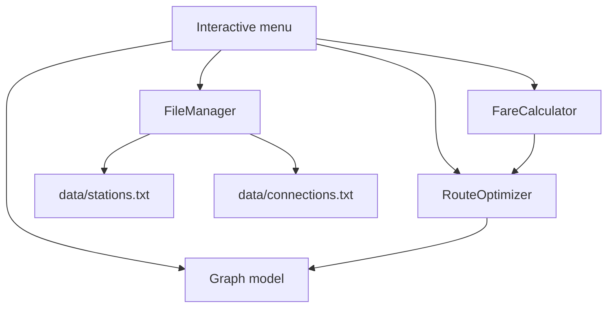

# Metro/Transport Route Optimization System

## Abstract

This project models a fictional transport network as a weighted graph and
provides route planning through a C++17 console application. Stations are
vertices, while connections are weighted edges containing distance and
estimated travel time. Dijkstra's algorithm finds minimum-distance and
fastest routes, BFS finds a route with the fewest connections, and DFS checks
reachability. Text files provide persistent storage, while a fare module and
interactive menu expose the system to a passenger or operator.

## Problem statement

A passenger may value different route criteria: physical distance, travel
time, or number of stops. A single route-selection rule cannot represent all
three goals. The system must store the network, reject invalid data, calculate
appropriate routes, reconstruct the complete station sequence, and report
passenger metrics without confusing graph edges with metro line transfers.

The network in this project is fictional and is not presented as a real metro
map.

## Objectives and scope

- Represent a transport network using a graph adjacency list.
- Support station and connection management with validation.
- Compare distance, time, and stop-count route optimization.
- Demonstrate vectors, queues, stacks, unordered maps, priority queues, and
  parent arrays.
- Persist stations and connections in separate text files.
- Provide fare estimation using a clearly documented academic pricing rule.
- Offer a menu suitable for demonstration and viva discussion.

The current scope does not model timetables, passenger demand, vehicle
capacity, actual metro lines, or line-transfer penalties.

## Requirements

### Functional requirements

1. Add, search, and list stations.
2. Add valid bidirectional or one-way connections.
3. Reject duplicate stations, duplicate edges, self-loops, unknown endpoints,
   and non-positive weights.
4. Find minimum-distance, fastest, and minimum-stop routes.
5. Check reachability.
6. Display distance, estimated time, and graph-edge count.
7. Estimate fare from the selected shortest-distance route.
8. Load and save station and connection files.
9. Handle missing, malformed, or incomplete files without crashing.

### Non-functional requirements

- C++17 and standard library only.
- Modular source files with clear ownership.
- Deterministic, readable console output.
- Input validation for interactive numeric values.
- No dependence on a database server or external library.

## System architecture



The `Graph` owns station IDs and adjacency storage. `RouteOptimizer` receives a
read-only graph reference. `FileManager` builds a temporary graph during load
and replaces the active graph only after validation succeeds. `main.cpp`
coordinates the modules and does not implement graph algorithms itself.

## Graph representation

A station receives an integer ID equal to its position in `stations_`. The
name-to-ID index is an `unordered_map<string, int>`. For station ID `u`,
`adjacencyList[u]` stores `Connection` records containing destination ID,
distance in kilometres, and travel time in minutes.

This adjacency-list representation uses $O(V + E)$ storage and is efficient
for sparse transport networks. A bidirectional physical connection is stored
as two directed adjacency entries. A one-way connection is stored as one
entry.

## Algorithms and pseudocode

### Dijkstra: distance or time

```text
set cost[source] = 0 and all other costs to infinity
push (0, source) into a min-priority queue
while the queue is not empty:
    remove the station with the smallest current cost
    skip it if the entry is stale
    for each outgoing connection:
        candidate = current cost + selected edge weight
        if candidate improves destination cost:
            update cost and parent
            push the new pair
reconstruct the destination by following parent entries
```

The selected edge weight is either kilometres or minutes. Dijkstra requires
non-negative weights, enforced when connections are inserted and loaded.

### BFS: minimum graph edges

```text
mark source visited and enqueue it
while the queue is not empty:
    dequeue a station
    for each unvisited neighbour:
        mark it, store its parent, and enqueue it
reconstruct the destination path from parent entries
```

BFS treats every edge as having cost one. It minimizes graph connections, not
physical distance or travel time.

### DFS: reachability

```text
push source onto a stack and mark it visited
while the stack is not empty:
    pop a station
    if it is the destination, return reachable
    push every unvisited neighbour
return not reachable
```

DFS answers a yes/no question and does not return an optimal route.

## Complexity analysis

| Operation      |  Time complexity |      Extra space | Reason                      |
| -------------- | ---------------: | ---------------: | --------------------------- |
| Station lookup |   $O(1)$ average |           $O(1)$ | Hash-table lookup           |
| Add connection |   $O(degree(u))$ | $O(1)$ auxiliary | Duplicate scan              |
| Dijkstra       | $O((V+E)\log V)$ |           $O(V)$ | Binary min-heap and arrays  |
| BFS            |         $O(V+E)$ |           $O(V)$ | Queue, visited, parent      |
| DFS            |         $O(V+E)$ |           $O(V)$ | Stack and visited           |
| File load/save |         $O(V+E)$ |         $O(V+E)$ | Records are read or written |

## Fare calculation

The academic sample rule is:

$$
fare = 10 + 5 \times distanceKm
$$

The system applies this rule only to a found shortest-distance route. The
values are fictional and should be replaced by a real tariff policy for a
production system.

## Testing and results

The test runner is `tests/test_runner.cpp` and is compiled with:

```bash
g++ -std=c++17 -Wall -Wextra -pedantic -I. \
  tests/test_runner.cpp Graph.cpp RouteOptimizer.cpp \
  FareCalculator.cpp FileManager.cpp -o test_runner
./test_runner
```

Verified cases:

| Case                         | Expected result                   | Result                    |
| ---------------------------- | --------------------------------- | ------------------------- |
| Direct route                 | Complete route returned           | Passed                    |
| Different distance options   | Dijkstra chooses least kilometres | Passed                    |
| Different time options       | Dijkstra chooses least minutes    | Passed                    |
| Fewer stops but longer route | BFS chooses fewer edges           | Passed                    |
| Unreachable station          | No route / false reachability     | Passed                    |
| Invalid station              | Rejected without crash            | Passed                    |
| Same source and destination  | Zero stops and zero cost          | Passed                    |
| Duplicate station/connection | Rejected                          | Passed                    |
| Empty or isolated network    | No route found                    | Covered by graph behavior |
| Missing or malformed file    | Load fails safely                 | Passed for malformed data |
| One-way connection           | Only forward adjacency entry      | Passed                    |
| Fare calculation             | Base plus distance charge         | Passed                    |

## Limitations and future enhancements

- Graph edges do not currently store line names, so graph-edge count is not
  the same as line-transfer count.
- Fare is distance-based and does not model zones, discounts, or ticket types.
- File saving writes the current adjacency entries as explicit directed records;
  this preserves reachability but does not retain the original bidirectional
  flag as a separate concept.
- Future work could add station closures, disabled connections, line-change
  penalties, alternative-route ranking, and degree-based station reports.

## Conclusion

The project demonstrates how the same weighted graph can support different
route objectives. Dijkstra is appropriate for non-negative distance or time
weights, BFS is appropriate when each connection has equal cost, and DFS is
appropriate for reachability. Separating the graph, algorithms, persistence,
fare, and menu modules makes the implementation easier to test, explain, and
extend.
